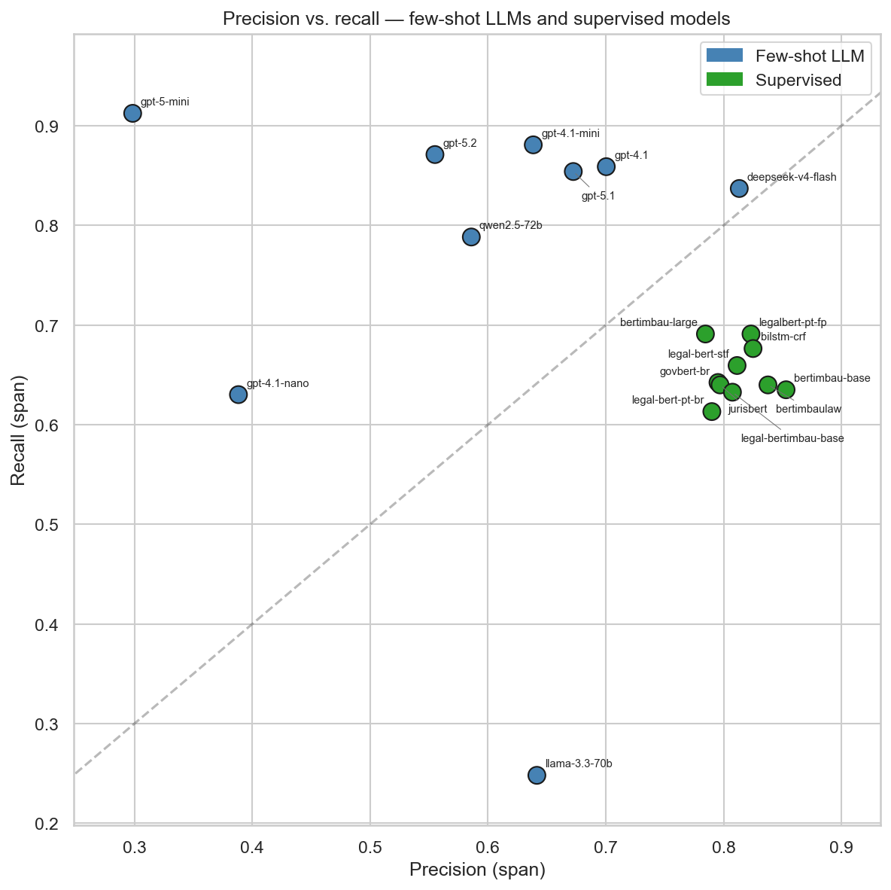

# DeciContas.br

**A Named Entity Recognition dataset of Brazilian audit-court decisions, and a controlled comparison of 19 extraction models on it.**

[](https://creativecommons.org/licenses/by/4.0/)
[](LICENSE)
[](pyproject.toml)

Brazilian **Courts of Accounts** (*Tribunais de Contas*) audit public spending. Their
rulings impose fines, binding obligations, reimbursements to the treasury and
non-binding recommendations — and each of those must be transcribed by hand into an
institutional registry that tracks whether the ruling was complied with. This
repository releases the corpus built to automate that step, together with everything
needed to reproduce the reported results.

The decisions come from the **Court of Accounts of the State of Rio Grande do Norte**
(TCE/RN, *Tribunal de Contas do Estado do Rio Grande do Norte*). It is, to our
knowledge, the first NER dataset over decisions of a Brazilian Court of Accounts.

Companion artefact to the dissertation *"Reconhecimento de Entidades Nomeadas em
Decisões do TCE/RN"* (Named Entity Recognition in TCE/RN Decisions), UFRN.

---

## The four entity types

Labels are kept in Portuguese because they name legal institutes, each with its own
enforcement regime — translating them would misrepresent the corpus.

| Label | What it is | Count |
|---|---|---:|
| `MULTA` | A pecuniary **fine** for administrative or fiscal misconduct | 203 |
| `OBRIGACAO` | A binding **obligation** imposed on the audited body | 123 |
| `RESSARCIMENTO` | A mandated **reimbursement** to the public treasury | 63 |
| `RECOMENDACAO` | A formally documented, non-binding **recommendation** to the audited body | 22 |

Recommendations and notices that a ruling addresses to the Court's own units (the
external-control secretariat SECEX, the legal counsel CONJU) are internal acts the
registry does not record, so they are not annotated (`research/annotation_scope.py`).

**861 documents, 411 entities.** Only 202 documents carry an entity; the remaining
659 are true negatives — filings and clean-account judgments with no registrable
command. They are kept deliberately: in production the system must also learn *not*
to extract. Spans are long (per-class medians of 248–357 characters), so evaluation
uses partial matching (IoU ≥ 0.5) rather than exact boundaries.

## Get the data

**Download** — grab a single file from the [latest release](https://github.com/eduardoplima/decicontas.br/releases/latest),
no clone required. **Or, in a clone**, the bundles are under [`data/`](data)
(a shortcut to `dataset/release/`).

```python
import json

docs = [json.loads(line) for line in open("data/decicontas/decicontas.jsonl")]
print(len(docs), sum(len(d["spans"]) for d in docs))   # 861 411
```

With HuggingFace `datasets`:

```python
from datasets import load_dataset

ds = load_dataset("json", data_files="data/decicontas/decicontas.jsonl")["train"]
```

One record, abridged:

```jsonc
{
  "id": "69",
  "text": "Vistos, relatados e discutidos estes autos, acatando o entendimento do ...",
  "tokens": ["Vistos,", "relatados", "e", "discutidos", "..."],
  "ner_tags": ["O", "O", "O", "O", "..."],          // BIO, one per token
  "token_offsets": [[0, 7], [8, 17], "..."],        // character span of each token
  "spans": [
    {"start_char": 266,  "end_char": 731,  "label": "MULTA"},
    {"start_char": 921,  "end_char": 1277, "label": "OBRIGACAO"}
  ]
}
```

Four formats ship per release: **JSON**, **JSONL** (HuggingFace-compatible),
**CoNLL-2003** BIO and **BRAT** standoff. See
[`dataset/release/README.md`](dataset/release/README.md) for the schema of each and
[`DATASHEET.md`](dataset/release/DATASHEET.md) for provenance, collection and intended
uses.

> **Schema note.** `decicontas.jsonl` uses `spans` with `start_char`/`end_char` and a
> string `id`; `decicontas.json` uses `entities` with `start`/`end` and an integer
> `id`. Same annotations, different field names — pick one and stay with it.

> **Personal data.** The names of natural persons who are parties to the proceedings
> are pseudonymised (synthetic names; see the DATASHEET, Section 2); the names of the
> Court's members are real. Do not use the corpus to profile the people it names.

## Results

Nine instruction-tuned LLMs under few-shot prompting with structured outputs, against
ten supervised baselines (BiLSTM-CRF, BERTimbau base/large, and seven Portuguese
legal- or government-domain encoders). One protocol for all: span F1 with IoU ≥ 0.5
over whitespace-token indices, paired document-level bootstrap (10,000 resamples) and
Holm correction over all 171 pairwise contrasts. LLM output strings are mapped to
character offsets by an exact-first aligner (fuzzy fallback only for paraphrased strings).

**Headline.** The best LLM, the open-weights **DeepSeek-V4-Flash** (macro span F1
**0.799**), exceeds the strongest supervised baseline, the legal-domain
**LegalBert-pt** (**0.613**), by +0.186, 95% CI [+0.097, +0.261], *p* < 0.001 — a
contrast that survives Holm correction over all 171 pairs (*p*<sub>Holm</sub> < 0.001),
as do the gaps to BERTimbau-large (0.605: +0.194) and BiLSTM-CRF (0.567: +0.230).
No contrast among the ten supervised models survives Holm correction: LegalBert-pt
differs from BERTimbau-large by +0.009, and the other six domain-adapted encoders
(0.518–0.552) sit at the level of the generic BERTimbau-base (0.524). The gap to GPT-4.1
(0.749) is +0.049, 95% CI [+0.016, +0.083], *p* = 0.002 — significant before but not
after Holm correction (*p*<sub>Holm</sub> = 0.192), so the two share the leader group
with GPT-5.1 (0.748). The advantage is concentrated on the rarest class: on
`RECOMENDACAO` (22 instances) the leading LLMs reach span F1 0.737–0.778 against at
most 0.231 for any supervised model, and five supervised models predict no
recommendation at all. On micro span F1 the gap shrinks to +0.074 and LegalBert-pt
(0.751) ranks fourth overall, behind three LLMs. Under exact boundary matching the
picture inverts: all ten supervised models (0.397–0.522) beat all nine LLMs (at most
0.373; LegalBert-pt 0.522 vs DeepSeek-V4-Flash 0.373).



Supervised models favour precision (0.785–0.853) over recall (0.613–0.691);
the leading LLMs lean toward recall (0.837–0.881, with precision 0.638–0.813). That profile motivates evaluating LLMs as
pre-annotators in a human-in-the-loop pipeline, although the relative cost of
correcting insertions versus omissions was not measured.

<details>
<summary><b>Full ranking — 19 models</b> (sorted by macro span F1)</summary>

| Model | Type | Token F1 | Span P | Span R | Span F1 (micro) | Span F1 (macro) |
|---|---|---:|---:|---:|---:|---:|
| DeepSeek-V4-Flash | LLM | 0.869 | 0.813 | 0.837 | 0.825 | **0.799** |
| GPT-4.1 | LLM | 0.841 | 0.700 | 0.859 | 0.772 | 0.749 |
| GPT-5.1 | LLM | 0.816 | 0.672 | 0.854 | 0.752 | 0.748 |
| GPT-4.1-mini | LLM | 0.825 | 0.638 | 0.881 | 0.740 | 0.719 |
| GPT-5.2 | LLM | 0.790 | 0.555 | 0.871 | 0.678 | 0.692 |
| LegalBert-pt | supervised | 0.796 | 0.823 | 0.691 | 0.751 | 0.613 |
| Qwen2.5-72B | LLM | 0.749 | 0.586 | 0.788 | 0.672 | 0.605 |
| BERTimbau-large | supervised | 0.797 | 0.785 | 0.691 | 0.735 | 0.605 |
| GPT-5-mini | LLM | 0.601 | 0.299 | 0.912 | 0.450 | 0.583 |
| BiLSTM-CRF | supervised | 0.813 | 0.825 | 0.676 | 0.743 | 0.567 |
| Legal-BERT-STF | supervised | 0.775 | 0.811 | 0.659 | 0.728 | 0.552 |
| GovBERT-BR | supervised | 0.748 | 0.795 | 0.642 | 0.711 | 0.539 |
| JurisBERT | supervised | 0.747 | 0.797 | 0.640 | 0.710 | 0.532 |
| Legal-BERTimbau-base | supervised | 0.750 | 0.807 | 0.633 | 0.709 | 0.530 |
| BERTimbauLaw | supervised | 0.761 | 0.838 | 0.640 | 0.726 | 0.527 |
| BERTimbau-base | supervised | 0.750 | 0.853 | 0.635 | 0.728 | 0.524 |
| LegalBERTPT-br | supervised | 0.734 | 0.790 | 0.613 | 0.690 | 0.518 |
| GPT-4.1-nano | LLM | 0.623 | 0.388 | 0.630 | 0.481 | 0.435 |
| Llama-3.3-70B | LLM | 0.416 | 0.642 | 0.248 | 0.358 | 0.250 |

Source: [`model_evaluation/C_main_results.csv`](dataset/results/models_outputs/model_evaluation/C_main_results.csv).
</details>

**Caveats the numbers carry.** Every model sees every document in full: the
encoders read long documents through overlapping 512-subword windows (stride 320) and
the BiLSTM-CRF takes up to 1,100 tokens, so no document is truncated
(`research.release.check_alignment` verifies it). Supervised learning rate and warmup were selected once on
a global 80/20 split rather than inside each cross-validation fold, which can bias
supervised scores upward. The ranking is stable across IoU thresholds 0.3–0.7 and
across all three reference annotations, but changes substantially under exact
matching.

Every number cited in the paper is regenerated into
[`model_evaluation/REPORT.md`](dataset/results/models_outputs/model_evaluation/REPORT.md), one section
per block, each showing its table inline next to the CSV that produced it.

## Annotation quality

Quality is measured, not asserted.

- **Label-error audit.** A confident-learning pass ([cleanlab](https://github.com/cleanlab/cleanlab))
  flagged 794 suspicious token groups; the 567 above an ensemble confidence of 0.95
  were reviewed one by one, and only 23 (4.1%) were actually changed — the audit
  mostly *confirmed* the original annotation. Both versions ship, paired.
- **Inter-annotator agreement.** The whole corpus was independently re-annotated,
  blind, by two staff of the Court unit that feeds the registry. Token-level Fleiss
  κ = **0.879** (pairwise Cohen's κ 0.864–0.899); pairwise span F1 between
  **0.824** and **0.838**. Details in
  [`corpus_and_agreement/AGREEMENT.md`](dataset/results/models_outputs/corpus_and_agreement/AGREEMENT.md).

## Reproduce

```bash
uv sync                                                           # install (Python 3.12)
uv run python -m research.release.evaluation_numbers                # all evaluation CSVs + REPORT.md
uv run python -m research.release.regenerate_figures              # the result figures
uv run python -m research.release.bootstrap_significance --quiet  # bootstrap CIs (N=10,000)
uv run pytest tests/                                              # test suite
```

Those run offline from a clean clone — the model outputs they score are versioned.
Two things are **not** needed to reproduce the tables: API credentials (only for
re-running LLM inference) and a GPU.

Re-running the supervised sweep is the expensive part (~29–32 h on Apple Silicon MPS):

```bash
DECICONTAS_DATASET_PATH=dataset/release/decicontas/decicontas-labelstudio.json \
uv run python -m research.kfold.orchestrate
```

## Repository layout

```
decicontas.br/
├── data/                 # → shortcut to dataset/release/
├── dataset/
│   ├── raw/              # source extracts, restricted to the annotated decisions (provenance)
│   ├── labeled_data/     # original Label Studio export
│   ├── errors/           # cleanlab audit decisions
│   ├── release/          # publishable bundles + DATASHEET.md + MANIFEST.json
│   └── results/          # models_outputs/ — every number and figure cited
├── notebooks/            # exploratory analysis, baselines, LLM evaluation
├── paper/                # camera-ready of the JURIX 2026 paper + README figure
├── research/             # the package the notebooks and scripts import
│   ├── dataset_io.py     # canonical tokenisation + BIO construction
│   ├── ner_metrics.py    # token/span F1, IoU bipartite matcher
│   ├── release/          # dataset export, number regeneration, bootstrap
│   └── kfold/            # supervised 5-fold CV
├── scripts/              # analysis + release packaging
└── tests/                # pytest suite
```

## Dataset versions

- **`decicontas/`** — the canonical release: 861 documents with the reviewed
  cleanlab corrections applied.
- **`decicontas-before-correction/`** — the same 861 documents with the original gold
  annotations, so the effect of the audit can be measured.

The 861 come from an 866-document Label Studio export, minus five documents reused
during prompt curation. All five carry no entities.

Releases (git tags; `CITATION.cff` carries the current one):

- **v1.0.0** — initial release (2026-09-05; last patch 2026-10-15): 441 entities.
- **v1.1.0** — 2026-10-17: annotation-scope guideline applied to both bundles —
  recommendations and notices addressed to the Court's own units are not entities;
  411 entities (22 `RECOMENDACAO`).
- **v1.2.0** — 2026-10-17: names of the natural persons who are parties to the
  proceedings pseudonymised (synthetic names, one token per token; the names of the
  Court's members are kept). Annotations, token counts and every reported metric are
  unchanged; the few-shot exemplars and the stored LLM predictions follow the same map.
  All results in the JURIX 2026 paper and in the dissertation refer to this release.
- Planned — adjudication of the annotator-study disagreements and decisions validated
  through the Court's human-in-the-loop registry pipeline.

## Paper

Lima EP, de Menezes-Neto EJ. *Few-Shot LLMs versus Domain-Adapted Encoders for Named
Entity Recognition in Decisions from a Brazilian Court of Accounts.* In: Legal Knowledge
and Information Systems — JURIX 2026. IOS Press; to appear.
[Author's camera-ready version](paper/decicontas_jurix2026.pdf); the published version
will be open access under CC BY-NC 4.0.

```bibtex
@inproceedings{lima2026decicontas,
  author    = {Lima, Eduardo Pereira and de Menezes-Neto, Elias Jacob},
  title     = {Few-Shot {LLMs} versus Domain-Adapted Encoders for Named Entity Recognition
               in Decisions from a {Brazilian} Court of Accounts},
  booktitle = {Legal Knowledge and Information Systems: JURIX 2026},
  publisher = {IOS Press},
  year      = {2026},
  note      = {To appear}
}
```

## Citation

Cite the dataset via [`CITATION.cff`](CITATION.cff) — GitHub renders it under *"Cite this
repository"*. A DOI will be added here on publication.

## License

Dual-licensed, see [`LICENSE`](LICENSE):

- **Data** (`dataset/`) — [CC BY 4.0](https://creativecommons.org/licenses/by/4.0/).
  The underlying decisions are public acts of the TCE/RN; the license covers the
  annotations, tokenisation, release bundles and documentation produced by the authors.
- **Code** (`research/`, `scripts/`, `tests/`, `notebooks/`) — MIT.
